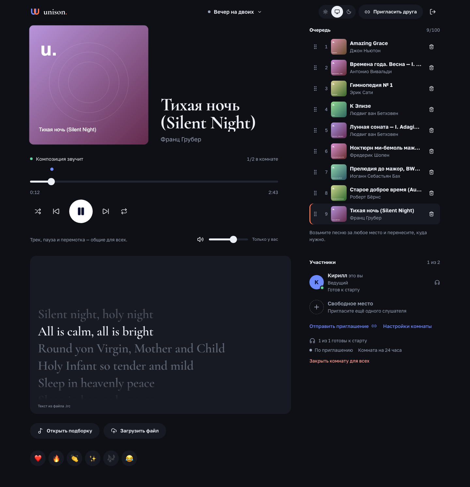

# Unison

Веб-приложение для совместного прослушивания музыки: создайте комнату, отправьте ссылку и слушайте один трек одновременно. Регистрация не нужна. Проект сделан для кейса «Слушаем вместе» хакатона «Время IT».




## Что умеет

- Комната до 10 человек, вход по ссылке-приглашению, при желании по одобрению ведущего.
- Общие пуск, пауза и перемотка; у каждого своя громкость.
- Подборка из девяти свободных записей и загрузка своих файлов (MP3, WAV, M4A) с обложкой из тегов.
- Общая очередь: песни переносятся перетаскиванием, повтор, перемешивание, предложения от слушателей.
- Текст песни в такт музыке (`.lrc`), обычный текст или текст из тегов файла.
- Уведомления о входе и заявках, реакции, светлая и тёмная темы, установка как PWA на телефон.

## Как это устроено

| Часть | Технологии |
| --- | --- |
| Фронтенд | React, TypeScript, Redux Toolkit, RTK Query, React Router, Vite |
| Бэкенд | Python, FastAPI, Pydantic, SQLAlchemy, Alembic, Celery |
| Данные | PostgreSQL, Redis, S3-совместимое хранилище (MinIO) |
| Аудио | FFmpeg в отдельном контейнере без сети |
| Инфраструктура | Docker Compose, Nginx, Prometheus, Grafana |

Состояние комнаты хранит сервер и раздаёт по WebSocket; браузеры сверяют часы с сервером и подстраивают воспроизведение. Подробнее в [архитектуре](docs/02-ARCHITECTURE.md).

## Быстрый старт

Нужны Docker Compose 2.24.4+ и Python 3.10+ (только для генерации ключей).

```bash
python3 infra/configure.py --output ../unison-runtime/docker
docker compose --env-file ../unison-runtime/docker/compose.env \
  -p unison -f compose.yaml -f compose.app.yaml up --build -d --wait
```

Приложение будет на http://localhost:8080. Ключи создаются один раз вне репозитория; не запускайте `configure.py` повторно с другим результатом для старых томов, иначе PostgreSQL не примет новый пароль. Подробности, HTTPS и резервные копии: [docs/DEPLOYMENT.md](docs/DEPLOYMENT.md).

Для разработки: бэкенд по [backend/README.md](backend/README.md), фронтенд по [frontend/README.md](frontend/README.md).

## Структура

| Папка | Что внутри |
| --- | --- |
| [`frontend/`](frontend/README.md) | клиент по Feature-Sliced Design, тесты и e2e |
| [`backend/`](backend/README.md) | API, воркер, миграции, каталог музыки, контракты |
| [`infra/`](infra/README.md) | Nginx, мониторинг, транскодер, скрипты запуска и резервного копирования |
| [`docs/`](docs/01-PRODUCT.md) | требования, архитектура, протокол, дизайн, отчёты |

## Документация

- Продукт и разработка: [требования](docs/01-PRODUCT.md), [архитектура](docs/02-ARCHITECTURE.md), [HTTP и WebSocket](docs/03-API-WS.md), [frontend flow](docs/04-FRONTEND-FLOW.md), [backend flow](docs/05-BACKEND-FLOW.md), [дизайн](docs/06-DESIGN.md), [истории](docs/07-EPICS-STORIES.md), [QA и выпуск](docs/08-QA-RELEASE.md).
- Реализация: [возможности и ограничения](docs/POST-MVP.md), [архитектура фронтенда](docs/FRONTEND-ARCHITECTURE.md), [текст песен](docs/KARAOKE.md), [Safari](docs/SAFARI-AUDIO-QA.md).
- Для хакатона: [аудит](docs/AUDIT.md), [замер синхронизации](docs/SYNC-BENCHMARK.md), [сценарий демо](docs/DEMO-SCRIPT.md).
- Работа с кодом и коммиты: [CONTRIBUTING.md](CONTRIBUTING.md).

## Проверки

```bash
cd backend && uv run ruff check . && uv run mypy app tests && uv run pytest
cd frontend && npm run architecture:check && npm run lint && npm run test && npm run build
```

GitHub Actions выполняет те же проверки, поднимает сервисы для интеграционных тестов и гоняет браузерные сценарии.
